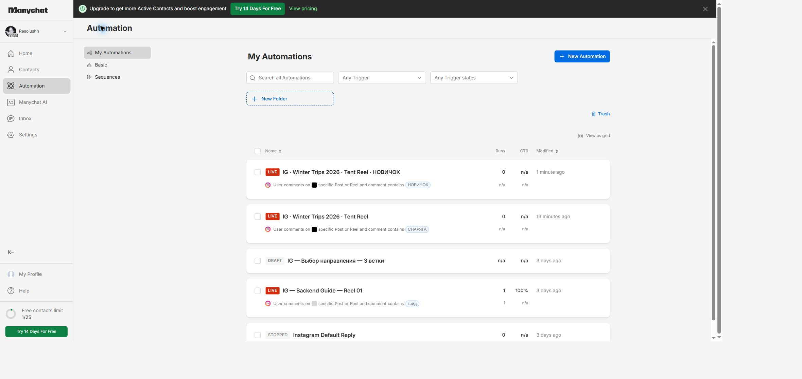
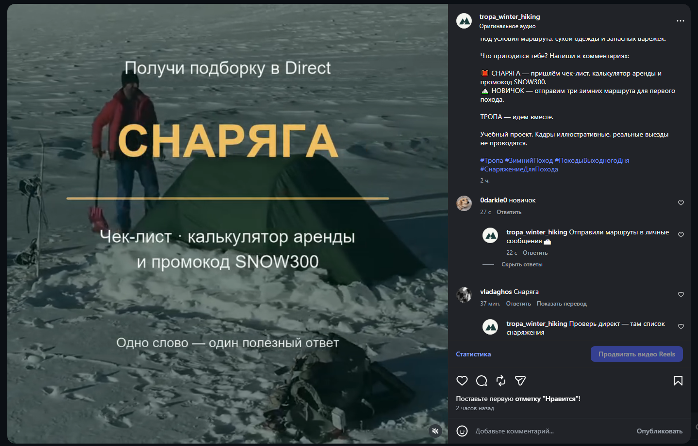
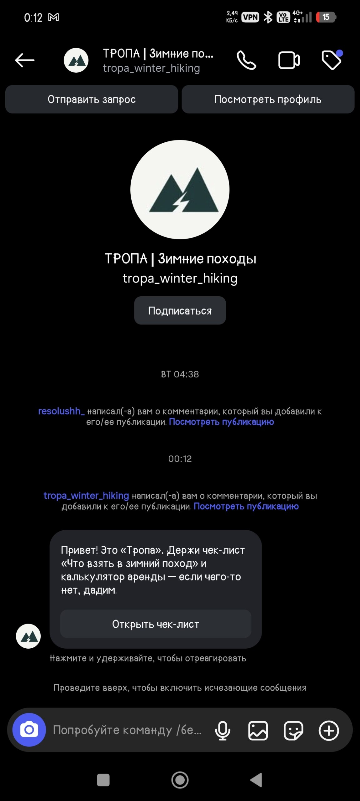
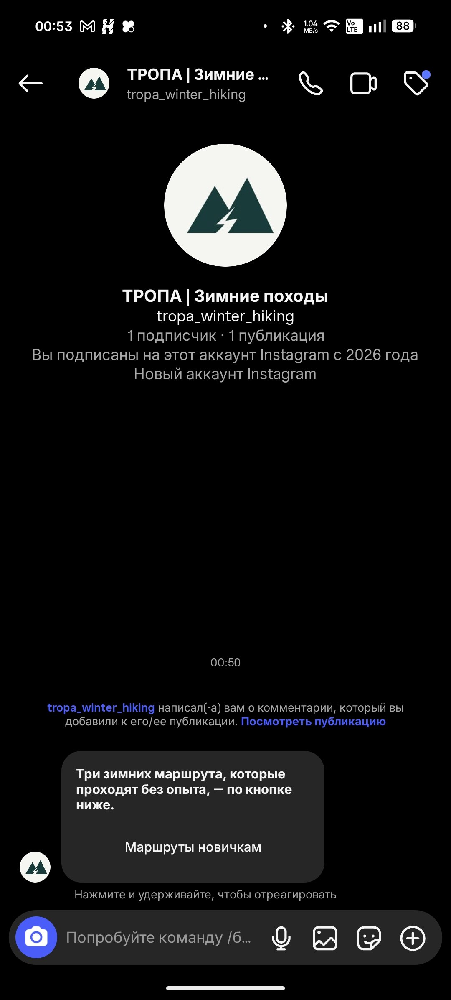
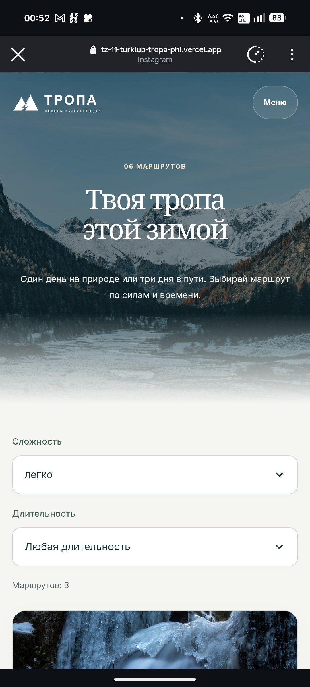

# Instagram и ManyChat

Аккаунт: https://www.instagram.com/tropa_winter_hiking/ . Reel: https://www.instagram.com/reel/DfFy1SzKrMz/ . Тема «Ночёвка в палатке при −15 °C», 41,5 секунды, музыка и титры без голосовой озвучки. Лицензированные иллюстративные кадры, маркировка учебного проекта. Обе автоматизации привязаны к одному конкретному Reel и переведены в Live.

## СНАРЯГА

[IG · Winter Trips 2026 · Tent Reel](https://app.manychat.com/fb5843515/cms/files/content20261029195713_836228/edit).

Ключевое слово СНАРЯГА, регистр не важен. Случайные публичные ответы: «Отправили чек-лист в личные сообщения 🏔», «Проверь директ — там список снаряжения», «Готово! Чек-лист и промокод уже в сообщениях».

Private reply: «Привет! Это „Тропа“. Держи чек-лист „Что взять в зимний поход“ и калькулятор аренды — если чего-то нет, дадим.» Кнопка «Открыть чек-лист» ведёт по U-02 из [реестра](utm.csv).

## НОВИЧОК

[IG · Winter Trips 2026 · Tent Reel · НОВИЧОК](https://app.manychat.com/fb5843515/cms/files/content20261029201740_536269/edit).

Ключевое слово НОВИЧОК. Три публичных ответа о маршрутах. Private reply: «Три зимних маршрута, которые проходят без опыта, — по кнопке ниже.» Кнопка «Маршруты новичкам» ведёт по U-03 на trips.html с якорем #easy. Название сокращено из-за лимита ManyChat.

## Подтверждения

Пользователь проверил ветки с внешних аккаунтов и предоставил снимки. Запись заявки REQ-478ab710-1a45-439c-bd01-6b63fe04ebd8 прочитана в leads: 30.10.2026 01:11:32, traverse, 25.12.2026, 1 участник, instagram/social/winter_trips_2026/reel_tent_01, new. В предоставленных снимках GA4 Realtime: generate_lead=1 и lead_source=instagram=1. Номер в GA4 не отправляется; это сверка теста по времени и источнику.

Заявка из ветки НОВИЧОК отдельно не проведена. На мобильных снимках целиком не видны все пять меток; полные адреса настроены по реестру, четыре метки СНАРЯГА дополнительно подтверждены строкой leads.

При тестах используйте аккаунты, которые ещё не комментировали этот Reel: [ManyChat описывает ограничение повторных запусков](https://help.manychat.com/hc/en-us/articles/14281316989724-Instagram-Post-and-Reel-Comments-trigger). Сообщение может оказаться в «Запросах».
