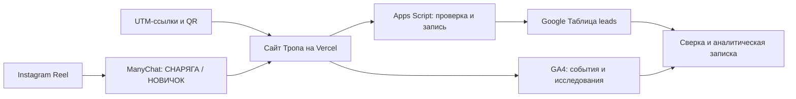
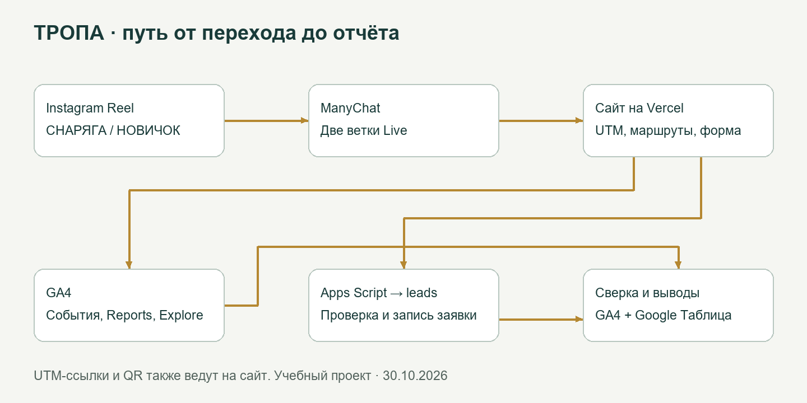
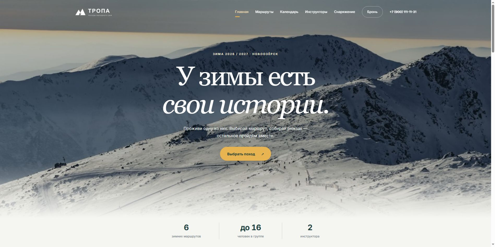

# Описание курсовой работы · ТЗ-11/2026 · «Тропа»

Исполнитель: Зотов Владислав Сергеевич, РПО 9/25/3. Проверки: 27–30 октября 2026. Сайт: https://tz-11-turklub-tropa-phi.vercel.app/ . Организация, маршруты и контактные данные учебные.

## 1. Задача

Создать сайт зимних походов, связать переходы из каналов с заявками и обеспечить измеримый путь до бронирования. Сайт должен помогать выбрать маршрут, дату и снаряжение; таблица — сохранять обращения с источниками. Коммерческие результаты вымышленного бизнеса не приписываются учебным тестам.

## 2. Схема

[Редактируемая SVG-схема](scheme.svg). DataLens в текущий объём не входит.

## 3. Сайт и дизайн

Восемь основных страниц и 404, шесть маршрутов, 13 учебных дат, фильтр сложности/длительности, калькулятор аренды и PDF-чек-лист. Согласованный современный дизайн с двумя вершинами в SVG-логотипе, полноширинными фото и плавным переходом в фон. Анимации учитывают reduced-motion. Источники фотографий: [images.md](images.md), [route-photos.md](route-photos.md).

Проверены 375/768/1280. Мобильный Lighthouse 29.10: 72/100/100/100. [Протокол](design-published.md).

## 4. GA4

G-JG7PNX1WWW. Семь специальных определений, три ключевых события проекта. 17 имён наблюдались в DebugView 28.10, три оставшихся подтверждены 30.10. Автоматический form_submit принадлежит форме booking-form; ручной дубль не добавлен. [События и снимки](events.md).

## 5. UTM и QR

12 URL рассчитаны формулами в [таблице](https://docs.google.com/spreadsheets/d/11_X-0ho07vGj-Q-Z5V2aeUz0e2_W9zXHBeM34XoDY_c/edit) и синхронизированы в [CSV](utm.csv)/[XLSX](utm.xlsx). Пять меток в URL, четыре UTM-столбца в заявке по схеме ТЗ. Партнёры dazai и Resolushh проверены. ВК/Telegram/YouTube — согласованные учебные переходы. Настоящий мобильный QR-тест подтвердил заявку и источник gearshop_qr в GA4.

## 6. Приём заявок

Apps Script проверяет поля и request_id, пишет leads, не доверяет статусу из браузера. Проверены дубликат и неправильный ID. Промокод SNOW300 сохраняется отдельно. После ok:true отправляется generate_lead с ограниченным ожиданием обработки тега, затем нативная навигация без контактов в URL. [Проверки](verification.md), [исправление form_submit](reports/form-submit-fixed-2026-10-30.md).

## 7. Instagram и ManyChat

Опубликован [Reel](https://www.instagram.com/reel/DfFy1SzKrMz/). СНАРЯГА отправляет чек-лист, аренду и промокод; НОВИЧОК — три лёгких маршрута. Две Live-автоматизации, ответы и Direct проверены с внешних аккаунтов. Учебная заявка из СНАРЯГА сверена с таблицей и Realtime. [Полный протокол с кадрами](manychat.md).

## 8. Анализ

Reports, свободная форма, четыре варианта воронки и прямой/обратный путь сохранены. Анализ не выдаёт учебные посещения за реальную аудиторию. Историческое расхождение таблицы и GA4 описано, точное Custom insight недоступно. [Аналитическая записка](report.md).

## 9. Результат

Пользователь может выбрать поход, подготовить снаряжение и отправить учебную заявку. Источник записывается вместе с заявкой; поведение измеряется в GA4. ManyChat выдаёт разные материалы по двум словам. Подтверждён путь QR и путь Instagram до заявки.

## 10. Ограничения и использование ИИ

Оповещение не создано из-за отсутствия Session source в конструкторе. Историческая сверка не дала полного совпадения; доставка старых событий не выдумана. Заявка из НОВИЧОК отдельно не проверена, U-01/U-04 не объявлены опубликованными. Telegram/WhatsApp — заглушки. DataLens и Viewer исключены пользователем. Презентация остаётся промежуточной.

ИИ использован для разработки и правок фронтенда, кода, формул и оформления документов, а также помощи с проверками в браузере. Числа взяты из сохранённых проверок. [Журнал задач](prompts.md), [статус требований](status.md).
