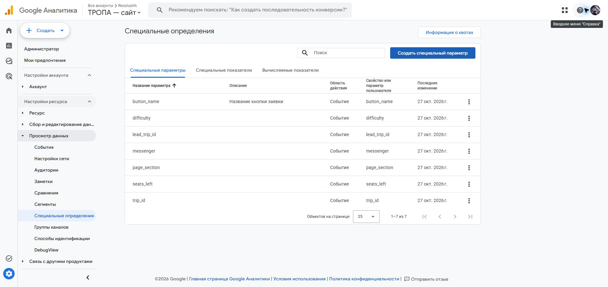
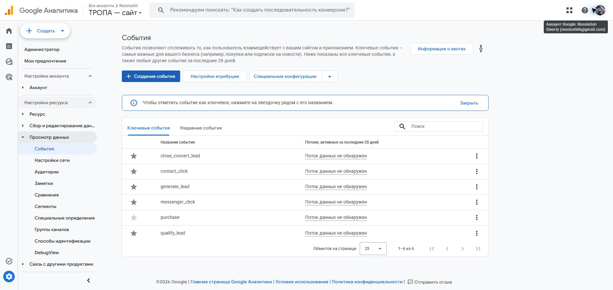

# Описание работы · ТЗ-11/2026 · Турклуб «Тропа»

Статус документа на 27.10.2026: описание подтверждённой части проекта. Работа продолжается. ФИО и группа исполнителя ещё не предоставлены.

Сайт: https://tz-11-turklub-tropa-phi.vercel.app/
Репозиторий: https://github.com/Resolushh/tz-11-turklub-tropa

## Задача

Связать выбор зимнего похода, рекламный источник и заявку. Посетитель должен выбрать маршрут и дату, оставить бронь, а клуб — увидеть заявку, её UTM и дальнейший статус. События сайта анализируются в GA4; итоговый дашборд должен объединить посещения и заявки.

## Сайт

Созданы девять HTML-страниц без сборки: главная, маршруты, календарь, инструкторы, снаряжение, контакты и бронь, благодарность, политика и 404. Шесть маршрутов используют цены, длительность и сложность из ТЗ. Фильтр «легко» показывает три маршрута. Выбор маршрута передаётся в форму.

Реализованы чек-лист, PDF, калькулятор аренды и копирование промокода. Контрольный расчёт спальника и коврика на двое суток — 1300 рублей. Вёрстка проверена при ширине 375, 768 и 1280 пикселей. Lighthouse ещё не выполнен.

Расписание, свободные места и сведения об инструкторах требуют исходных данных. Сейчас сайт сообщает об отсутствии согласованного расписания.

## Аналитика

Ресурс «ТРОПА — сайт», Property ID 560936809, Measurement ID G-JG7PNX1WWW. Тег установлен в head всех девяти страниц. В интерфейсе GA4 сохранены семь параметров уровня события: button_name, page_section, difficulty, trip_id, seats_left, lead_trip_id, messenger.

В ключевые события добавлены generate_lead, contact_click и messenger_click. В ресурсе также остались автоматически созданные Google события; соответствие требованию «других ключевых событий нет» ещё требует проверки настроек.

Поступление событий пока не подтверждено: при контрольном посещении Realtime показывал ноль пользователей. Наличие тега и настроенных определений само по себе не подтверждает сбор данных. DebugView ещё не проверен.

## Приём заявок

Форма проверяет имя, телефон, необязательный e-mail, маршрут, дату, количество участников и согласия. Скрытые поля содержат REQ-UUID и четыре UTM-метки, сохранённые в sessionStorage. Событие generate_lead вызывается только после успешного ответа приёмника.

Код Apps Script проверяет данные повторно, отклоняет дубликаты, ставит серверное время и status=new, экранирует строки с признаками формул. Локальные проверки с mock Google API пройдены; это не проверка живой интеграции.

Создана частная Google Таблица и связанный проект Apps Script «ТРОПА — приём заявок». Код сохранён, SPREADSHEET_ID настроен. Первый запуск setup остановился на подтверждении личности Google. Лист leads ещё не подготовлен, веб-приложение не развёрнуто, bookingEndpoint пуст. Отправка заявок на опубликованном сайте пока недоступна.

## UTM, ManyChat и отчёты

Подготовлены две ветки ManyChat: СНАРЯГА и НОВИЧОК; сценарий и адреса кнопок находятся в manychat.md. Живая автоматизация, публикации, переходы от партнёров и реестр из 12 ссылок ещё не завершены.

Данные GA4, выгрузки отчётов и дашборд DataLens отсутствуют. Выводы об эффективности каналов пока делать нельзя. Отчёты по ТЗ создаются после реальных проверок и обработки данных в течение 24–48 часов.

## Использование ИИ и дальнейшая работа

ИИ применялся для HTML/CSS/JS, серверной проверки формы, текстов и документации. Фактические запросы записаны в prompts.md. Следующие этапы: завершить авторизацию Apps Script, проверить заявку с UTM, подтвердить события, выполнить публикации и ManyChat, собрать отчёты, подготовить схему и презентацию. Завершённость этих этапов будет подтверждаться отдельными кадрами.