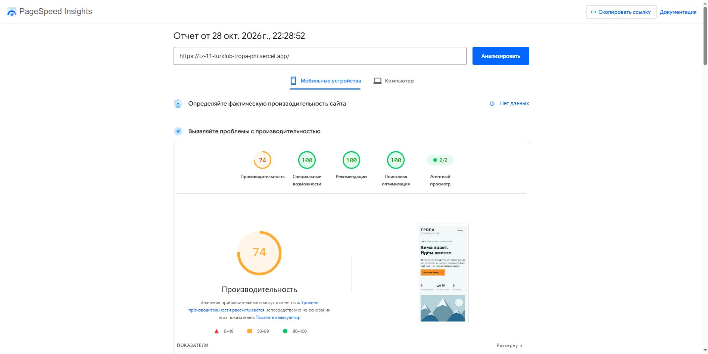

# Lighthouse: главная страница, мобильный режим

Проверен опубликованный адрес https://tz-11-turklub-tropa-phi.vercel.app/ .

[Оригинальный отчёт PageSpeed Insights](https://pagespeed.web.dev/analysis/https-tz-11-turklub-tropa-phi-vercel-app/2iltf18bnn?form_factor=mobile), 28.10.2026 22:28:52 МСК.

- Performance: **74**, требование ТЗ ≥70 — выполнено.
- Accessibility: **100**, требование ТЗ ≥90 — выполнено.
- SEO: **100**, требование ТЗ ≥90 — выполнено.
- Best Practices: 100 (дополнительный показатель).

Lighthouse 13.5.0, эмуляция Moto G Power, медленная 4G, начальная загрузка одной страницы; HeadlessChromium 153.0.8010.36. FCP 3,8 с, LCP 4,4 с, TBT 0 мс, CLS 0, Speed Index 5,0 с. Это лабораторный замер; полевых данных CrUX для сайта нет. Баллы могут изменяться при повторных запусках.

Порог раздела 3.3 ТЗ выполнен данным замером. Он не заменяет проверки остальных страниц, ручной доступности или реального мобильного сеанса GA4.

